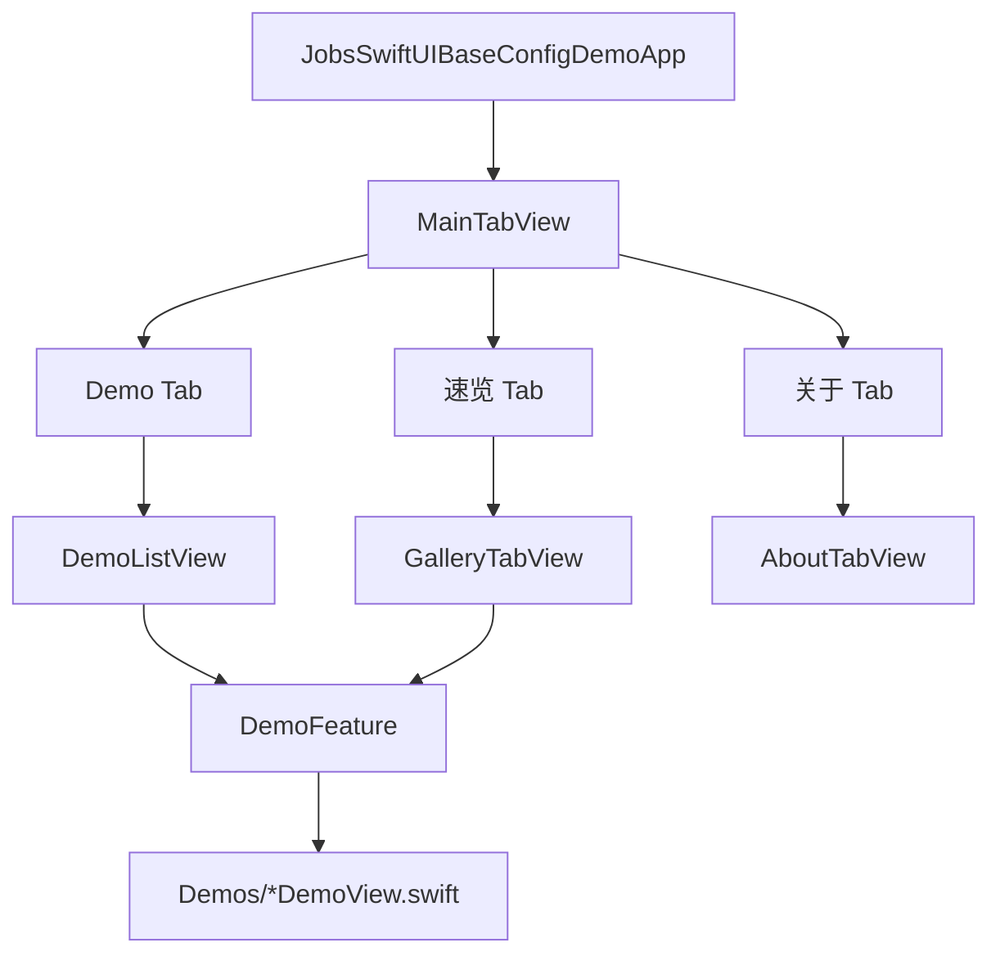
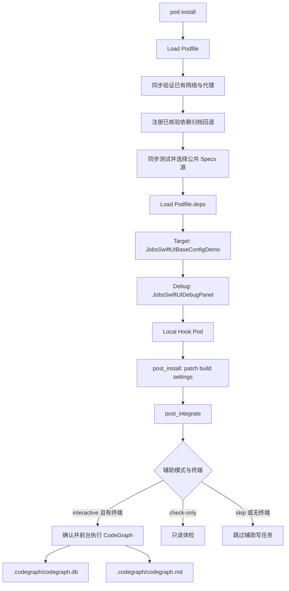
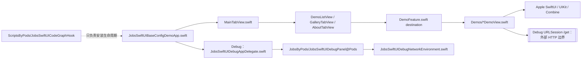
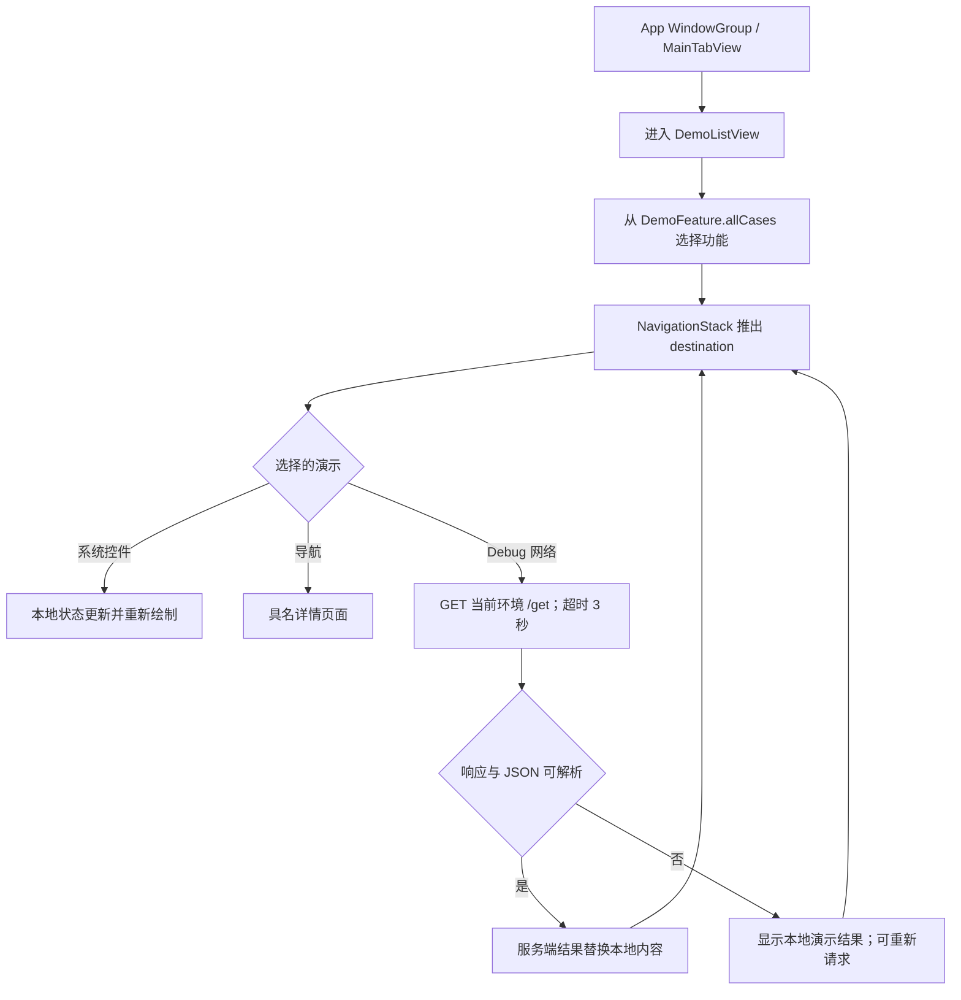
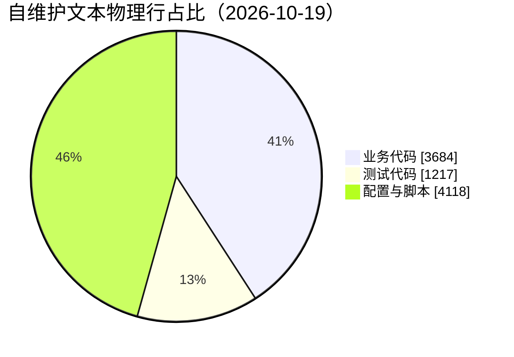

# `JobsSwiftUIBaseConfigDemo`

> **项目定位：** `JobsSwiftUIBaseConfigDemo`，面向 iOS 开发者的原生 SwiftUI 系统控件、导航与状态交互演示工程，用于学习与验证纯 SwiftUI 页面组织。
>
> **状态与维护：** 维护中（本地提交历史见统计章节）；负责人 Jobs，未登记独立维护团队。运行 / 硬件 / 生产功能须按对应证据验收。
>
> **统计基线：** 2026-10-19（Asia/Shanghai）；[项目规模、依赖与接手指南](#project-statistics)，页面、源码和提交分别采用明确口径，原有教程与历史记录继续保留。


<!-- jobs-toc:start -->
<!-- jobs-toc:source {"v":2,"token":"[toc]"} -->
<details>
<summary>📚 目录（点击展开 / 收起）</summary>

- [🔥 前言](#jobs-toc-heading-1)
- [一、工程信息](#jobs-toc-heading-2)
- [二、目录结构](#jobs-toc-heading-3)
- [三、入口流程](#jobs-toc-heading-4)
- [四、功能清单](#jobs-toc-heading-5)
- [五、重点实现](#jobs-toc-heading-6)
  - [5.1、TabBar 结构](#jobs-toc-heading-7)
  - [5.2、列表推出 Demo 页面](#jobs-toc-heading-8)
  - [5.3、自定义双色圆形 Gauge](#jobs-toc-heading-9)
  - [5.4、Timer 定时器](#jobs-toc-heading-10)
  - [5.5、四向 Push 预览](#jobs-toc-heading-11)
  - [5.6、Debug 环境与动作](#jobs-toc-heading-12)
- [六、项目配置支持](#jobs-toc-heading-13)
  - [6.1、当前定位](#jobs-toc-heading-14)
  - [6.2、安装与构建自动挂载脚本](#jobs-toc-heading-15)
    - [6.2.1、真机 Run 构建后的 IPA 留存](#build-ipa-retention)
  - [6.3、脚本日志](#jobs-toc-heading-17)
  - [6.4、文档目录的源仓维护与首次克隆验收](#markdown-toc-workflow)
- [七、运行方式](#jobs-toc-heading-19)
  - [7.1、使用 Xcode 运行](#jobs-toc-heading-20)
  - [7.2、使用命令行编译](#jobs-toc-heading-21)
  - [7.3、生成 CodeGraph](#jobs-toc-heading-22)
  - [7.4、自动输出构建产物](#jobs-toc-heading-23)
- [八、扩展 Demo](#jobs-toc-heading-24)
- [九、注意事项](#jobs-toc-heading-25)
- [十、排查方式](#jobs-toc-heading-26)
- [十一、项目统计与接手指南](#project-statistics)
  - [11.1、SDK、工具链与锁文件](#statistics-toolchain)
  - [11.2、Git 历史与统计边界](#statistics-history)
  - [11.3、页面、子页面与路由](#statistics-pages)
  - [11.4、后端规模适用边界](#statistics-backend)
  - [11.5、模块依赖与核心流程](#statistics-flows)
  - [11.6、功能实现与证据](#statistics-features)
  - [11.7、业务代码占比与复核命令](#statistics-code-share)
  - [11.8、直接依赖清单与风险](#statistics-dependencies)
  - [11.9、运行、构建、测试与常见问题](#statistics-run)
- [十二、iPhone Duo 与动态窗口适配](#iphone-duo)

</details>
<!-- jobs-toc:end -->

---

## <span id="jobs-toc-heading-1" data-jobs-toc="v2">🔥 <font id=前言>前言</font></span><!-- jobs-toc:heading-end -->

`JobsSwiftUIBaseConfigDemo` 是一个纯原生 [**Swift**](https://www.swift.org/) / [**SwiftUI**](https://developer.apple.com/xcode/swiftui/) iOS Demo 工程，用来集中演示系统 UI 组件和常见交互写法。

工程入口模拟 iOS 新工程的基础结构：启动后先进入主 `TabView`，其中 `Demo` Tab 是功能列表，点击列表功能名后通过 `NavigationStack` 推出对应 Demo 页面。

本工程使用原生 SwiftUI 演示系统组件；Debug 额外接入独立的本地 `JobsSwiftUIDebugPanel` Pod，演示圆形浮层、环境切换和自定义动作。Release 不链接调试 Pod，也不显示调试 Demo。

工程使用 [**CocoaPods**](https://cocoapods.org/) 入口：`Podfile` 加载解耦后的 `Podfile.deps`，在 `pod install` 收尾阶段挂载 [**CodeGraph**](https://github.com/colbymchenry/codegraph) 脚本生成 `.codegraph`。依赖清单包含本地脚本锚点和仅 Debug 生效的 SwiftUI 调试 Pod；调试 Pod 无其它业务 Pod 依赖。

| 安装环节 | 当前行为 |
| --- | --- |
| 网络链路 | `pod install` / `pod update` 先同步实测当前链路，必要时验证机器上已配置、已启用的代理，并让后续源码下载继承同一进程环境 |
| 公共 Specs | 依据官方 CDN 与 Git Specs 的真实请求结果选源，替代固定 `https://github.com/CocoaPods/Specs.git` |
| 源码归档 | 仅已核验的 `AMPopTip 4.12.0` Git 网络失败可回退官方固定提交归档；本工程目前只有本地 Pod，不会触发该白名单 |
| 安装后任务 | 保留原有 `post_install` 工程设置；`post_integrate` 前台确认并执行 CodeGraph，继承终端输入并等待真实结果；网络增强异常只告警，依赖安装失败仍由 CocoaPods 正常报告 |

## <span id="jobs-toc-heading-2" data-jobs-toc="v2">一、工程信息 <a href="#前言" style="font-size:17px; color:green;"><b>🔼</b></a> <a href="#🔚" style="font-size:17px; color:green;"><b>🔽</b></a></span><!-- jobs-toc:heading-end -->

| 项目 | 说明 |
| --- | --- |
| 工作区文件 | `./JobsSwiftUIBaseConfigDemo.xcworkspace` |
| 工程文件 | `./JobsSwiftUIBaseConfigDemo.xcodeproj` |
| App 入口 | `./JobsSwiftUIBaseConfigDemo/JobsSwiftUIBaseConfigDemoApp.swift` |
| 主 Tab 容器 | `./JobsSwiftUIBaseConfigDemo/MainTabView.swift` |
| Demo 列表 | `./JobsSwiftUIBaseConfigDemo/DemoListView.swift` |
| Demo 注册表 | `./JobsSwiftUIBaseConfigDemo/DemoFeature.swift` |
| Demo 页面目录 | `./JobsSwiftUIBaseConfigDemo/Demos/` |
| Podfile 入口 | `./Podfile` |
| Pod 依赖清单 | `./Podfile.deps` |
| Pod 挂载脚本 | `./ScriptsByPods/` |
| 脚本锚点 Pod | `./ScriptsByPods/JobsSwiftUICodeGraphHook/` |
| Debug 调试 Pod | [JobsSwiftUIDebugPanel](./JobsByPods/JobsSwiftUIDebugPanel@Pods/README.md) |
| 框架配置说明 | [SwiftUI 工程项目框架配置方案](./SwiftUIDoc.md/SwiftUI工程项目框架配置方案@Jobs.md/SwiftUI工程项目框架配置方案@Jobs.md) |
| Bundle ID | `com.jobs.jobsswiftuibaseconfigdemo` |
| 最低系统 | iOS `17.0` |
| 支持平台 | `iphoneos` / `iphonesimulator` |
| 依赖方式 | 本地脚本锚点；Debug 专用独立 SwiftUI 调试 Pod |

## <span id="jobs-toc-heading-3" data-jobs-toc="v2">二、目录结构 <a href="#前言" style="font-size:17px; color:green;"><b>🔼</b></a> <a href="#🔚" style="font-size:17px; color:green;"><b>🔽</b></a></span><!-- jobs-toc:heading-end -->

```text
.
├── README.md
├── icon.png
├── Podfile
├── Podfile.deps
├── JobsByPods
│   └── JobsSwiftUIDebugPanel@Pods    # Debug 专用原生 SwiftUI 调试框架
├── SwiftUIDoc.md
│   └── SwiftUI工程项目框架配置方案@Jobs.md
├── ScriptsByDevTools
│   └── save_device_ipa_after_build.sh
├── build                         # 仅保留本次真机.ipa 或模拟器.ipa
├── ScriptsByPods
│   ├── README.md
│   ├── JobsSwiftUICodeGraphHook
│   ├── 【MacOS】🌐CocoaPods网络适配.command
│   ├── 【MacOS】🌐CocoaPods源自动选择.command
│   ├── codegraph_init.command
│   └── codegraph_export_md.command
├── JobsSwiftUIBaseConfigDemo.xcworkspace
├── JobsSwiftUIBaseConfigDemo.xcodeproj
└── JobsSwiftUIBaseConfigDemo
    ├── Assets.xcassets
    ├── JobsSwiftUIBaseConfigDemoApp.swift
    ├── JobsSwiftUIDebugAppDelegate.swift
    ├── JobsSwiftUIDebugNetworkEnvironment.swift
    ├── MainTabView.swift
    ├── DemoListView.swift
    ├── DemoFeature.swift
    ├── DemoFeatureRow.swift
    ├── GalleryTabView.swift
    ├── AboutTabView.swift
    └── Demos
        ├── TextImageDemoView.swift
        ├── ButtonMenuDemoView.swift
        ├── InputFieldsDemoView.swift
        ├── ControlValuesDemoView.swift
        ├── PickersDemoView.swift
        ├── ProgressGaugeDemoView.swift
        ├── CustomCircularGaugeView.swift
        ├── ListFormDemoView.swift
        ├── NavigationDemoView.swift
        ├── DirectionalPushDemoView.swift
        ├── AlertDialogDemoView.swift
        ├── PresentationDemoView.swift
        ├── LayoutDemoView.swift
        ├── TabPageDemoView.swift
        ├── DisclosureOutlineDemoView.swift
        ├── AsyncLinkShareDemoView.swift
        ├── AnimationDemoView.swift
        ├── TimerDemoView.swift
        └── JobsSwiftUIDebugPanelDemoView.swift
```

## <span id="jobs-toc-heading-4" data-jobs-toc="v2">三、入口流程 <a href="#前言" style="font-size:17px; color:green;"><b>🔼</b></a> <a href="#🔚" style="font-size:17px; color:green;"><b>🔽</b></a></span><!-- jobs-toc:heading-end -->



主流程说明：

- `JobsSwiftUIBaseConfigDemoApp` 使用 `WindowGroup` 加载 `MainTabView`。
- `MainTabView` 使用 `TabView` 提供 `Demo`、`速览`、`关于` 三个 Tab。
- `DemoListView` 使用 `NavigationStack`、`List`、`NavigationLink` 组织功能列表。
- `DemoFeature` 是 Demo 注册表，集中维护功能名、描述、图标和目标页面。
- `Demos/` 目录下每个文件对应一个独立演示页面。
- Debug 的 App 通过 `@UIApplicationDelegateAdaptor` 配置调试 Pod，再用根视图 `.jobsSwiftUIDebugPanel()` 绑定每个业务场景。浮层有独立 `NavigationStack`，完整保留各 Tab 的导航状态。

## <span id="jobs-toc-heading-5" data-jobs-toc="v2">四、功能清单 <a href="#前言" style="font-size:17px; color:green;"><b>🔼</b></a> <a href="#🔚" style="font-size:17px; color:green;"><b>🔽</b></a></span><!-- jobs-toc:heading-end -->

| 功能名 | 演示内容 | 对应文件 |
| --- | --- | --- |
| `Text / Label / Image` | 文本、`Label`、SF Symbols 与基础图片展示 | `./JobsSwiftUIBaseConfigDemo/Demos/TextImageDemoView.swift` |
| `Button / Menu / ControlGroup` | 按钮样式、菜单、按钮组和角色按钮 | `./JobsSwiftUIBaseConfigDemo/Demos/ButtonMenuDemoView.swift` |
| `TextField / SecureField / TextEditor` | 单行输入、密码输入、多行文本和键盘焦点 | `./JobsSwiftUIBaseConfigDemo/Demos/InputFieldsDemoView.swift` |
| `Toggle / Slider / Stepper` | 开关、滑杆、步进器等数值交互 | `./JobsSwiftUIBaseConfigDemo/Demos/ControlValuesDemoView.swift` |
| `Picker / DatePicker / ColorPicker` | 分段选择、滚轮选择、日期和颜色选择 | `./JobsSwiftUIBaseConfigDemo/Demos/PickersDemoView.swift` |
| `ProgressView / Gauge` | 进度条、加载指示器、线性 Gauge 和自定义圆形 Gauge | `./JobsSwiftUIBaseConfigDemo/Demos/ProgressGaugeDemoView.swift` |
| `List / Form / Section` | 列表、表单、分组和只读信息行 | `./JobsSwiftUIBaseConfigDemo/Demos/ListFormDemoView.swift` |
| `NavigationStack / Toolbar` | 导航推出、工具栏按钮和层级页面 | `./JobsSwiftUIBaseConfigDemo/Demos/NavigationDemoView.swift` |
| `Directional Push VC` | 从上、下、左、右四个方向按百分比 Push 页面 | `./JobsSwiftUIBaseConfigDemo/Demos/DirectionalPushDemoView.swift` |
| `Alert / ConfirmationDialog` | 系统弹窗、确认弹窗和破坏性操作 | `./JobsSwiftUIBaseConfigDemo/Demos/AlertDialogDemoView.swift` |
| `Sheet / Popover / FullScreenCover` | 模态页面、浮层和全屏展示 | `./JobsSwiftUIBaseConfigDemo/Demos/PresentationDemoView.swift` |
| `ScrollView / LazyVGrid / Grid` | 滚动容器、自适应网格和新式 `Grid` | `./JobsSwiftUIBaseConfigDemo/Demos/LayoutDemoView.swift` |
| `TabView 分页` | 分页 `TabView` 和索引切换 | `./JobsSwiftUIBaseConfigDemo/Demos/TabPageDemoView.swift` |
| `DisclosureGroup / OutlineGroup` | 折叠分组和树形结构 | `./JobsSwiftUIBaseConfigDemo/Demos/DisclosureOutlineDemoView.swift` |
| `AsyncImage / Link / ShareLink` | 远程图片、外链打开和系统分享 | `./JobsSwiftUIBaseConfigDemo/Demos/AsyncLinkShareDemoView.swift` |
| `Animation / Transition` | 状态驱动动画、转场和显隐 | `./JobsSwiftUIBaseConfigDemo/Demos/AnimationDemoView.swift` |
| `Timer 定时器` | 非 UI 控件：`Timer.publish`、`autoconnect` 和 `onReceive` | `./JobsSwiftUIBaseConfigDemo/Demos/TimerDemoView.swift` |
| `SwiftUI Debug 调试面板` | Debug 圆形悬浮按钮、环境选择、顺序动作、真实 `GET /get` 与失败回退 | `./JobsSwiftUIBaseConfigDemo/Demos/JobsSwiftUIDebugPanelDemoView.swift` |

## <span id="jobs-toc-heading-6" data-jobs-toc="v2">五、重点实现 <a href="#前言" style="font-size:17px; color:green;"><b>🔼</b></a> <a href="#🔚" style="font-size:17px; color:green;"><b>🔽</b></a></span><!-- jobs-toc:heading-end -->

### <span id="jobs-toc-heading-7" data-jobs-toc="v2">5.1、TabBar 结构 <a href="#前言" style="font-size:17px; color:green;"><b>🔼</b></a> <a href="#🔚" style="font-size:17px; color:green;"><b>🔽</b></a></span><!-- jobs-toc:heading-end -->

`MainTabView` 使用 SwiftUI 的 `TabView` 实现主 TabBar：

```swift
TabView(selection: $selectedTab) {
    DemoListView()
        .tabItem {
            Label("Demo", systemImage: "list.bullet.rectangle")
        }
        .tag(AppTab.demos)
}
```

### <span id="jobs-toc-heading-8" data-jobs-toc="v2">5.2、列表推出 Demo 页面 <a href="#前言" style="font-size:17px; color:green;"><b>🔼</b></a> <a href="#🔚" style="font-size:17px; color:green;"><b>🔽</b></a></span><!-- jobs-toc:heading-end -->

`DemoListView` 通过 `NavigationStack` 包住 `List`，每个功能项都是一个 `NavigationLink`：

```swift
NavigationLink {
    feature.destination
        .navigationTitle(feature.title)
        .navigationBarTitleDisplayMode(.inline)
} label: {
    DemoFeatureRow(feature: feature)
}
```

首页列表支持长按 cell 后拖拽排序，排序结果通过 `AppStorage` 写入 `UserDefaults`。再次进入 `DemoListView` 时，会优先读取已保存顺序；新增 Demo 未出现在旧顺序里时会自动追加到列表末尾。

### <span id="jobs-toc-heading-9" data-jobs-toc="v2">5.3、自定义双色圆形 Gauge <a href="#前言" style="font-size:17px; color:green;"><b>🔼</b></a> <a href="#🔚" style="font-size:17px; color:green;"><b>🔽</b></a></span><!-- jobs-toc:heading-end -->

`CustomCircularGaugeView` 用 `Circle().trim(...)` 分别绘制两段弧线：

- 已走过的弧线使用 `completedColor`，默认蓝色。
- 未走过的弧线使用 `remainingColor`，默认浅灰。
- 小圆点根据 `progress` 计算角度和坐标，跟随当前进度移动。

这个写法用于解决系统 `Gauge` 圆形样式不方便细分“走过 / 未走过”颜色的问题。

### <span id="jobs-toc-heading-10" data-jobs-toc="v2">5.4、Timer 定时器 <a href="#前言" style="font-size:17px; color:green;"><b>🔼</b></a> <a href="#🔚" style="font-size:17px; color:green;"><b>🔽</b></a></span><!-- jobs-toc:heading-end -->

`TimerDemoView` 使用 `Timer.publish(every:on:in:)` 创建发布器，并通过 `onReceive` 每秒更新页面状态：

```swift
private let ticker = Timer.publish(every: 1, on: .main, in: .common).autoconnect()
```

### <span id="jobs-toc-heading-11" data-jobs-toc="v2">5.5、四向 Push 预览 <a href="#前言" style="font-size:17px; color:green;"><b>🔼</b></a> <a href="#🔚" style="font-size:17px; color:green;"><b>🔽</b></a></span><!-- jobs-toc:heading-end -->

`DirectionalPushDemoView` 使用分段选择控制 Push 方向，使用 `Slider` 控制 Push 百分比，并在预览区域模拟从上、下、左、右四个方向进入目标 VC 页面。

### <span id="jobs-toc-heading-12" data-jobs-toc="v2">5.6、Debug 环境与动作 <a href="#前言" style="font-size:17px; color:green;"><b>🔼</b></a> <a href="#🔚" style="font-size:17px; color:green;"><b>🔽</b></a></span><!-- jobs-toc:heading-end -->

圆形 `UIButton` 由 `UIViewRepresentable` 桥接，只显示本地打包背景图，点击推出工具 `List`，首项固定为“App 环境切换”，再按 `byActions` 数组顺序展示“SwiftUI 调试面板使用示例”和“查看当前环境”。入口保留在调试导航栈上方，菜单、环境页和使用示例中再次点击均关闭面板，返回打开前的业务页面；重新打开回到工具列表，保留业务导航状态与所选环境。入口支持单指拖动并钳制在安全区域，旋转后按相对位置重算；拖动不会额外触发点击或长按。长按隐藏当前进程全部按钮，前后台切换保持隐藏，重新启动 App 恢复。

根视图修饰符观察宿主真实 `colorScheme`，浮窗及已打开的工具页、环境页同步使用宿主主题。Debug 使用示例提供“跟随系统／白天／黑夜”选择，App 根视图以 `preferredColorScheme` 消费该演示偏好；跟随系统时保留实时系统变化。调试 Pod 不新增公开主题 API，也不读取宿主偏好键。

`JobsSwiftUIDebugAppDelegate` 使用 `byIdentifier`、`byTitle`、`byBaseURL` 配置“本地 Mock / 公共测试 / 联调测试”三组环境，默认地址依次为 `http://127.0.0.1:18080`、`https://httpbin.org`、`https://postman-echo.com`。选择标识写入 `UserDefaults`，启动时恢复；回调更新 Demo 的网络配置。

Demo 进入或重新请求时真实访问当前环境 `GET /get`，超时 3 秒，先显示本地示例，请求成功后使用服务器 JSON，失败或解析无效继续使用本地示例，重试成功自动恢复真数据。环境变更取消旧任务，避免旧环境响应覆盖新页面。真机使用本地 Mock 时需配置可访问的开发机 IP。

默认弱网项按能力边界省略。设备级弱网使用 Apple [**Network Link Conditioner**](https://developer.apple.com/library/archive/documentation/FileManagement/Conceptual/On_Demand_Resources_Guide/TestingPerformance.html) 的开发者设置。资源来源、许可、完整 DSL 与窗口穿透说明见 [调试 Pod README](./JobsByPods/JobsSwiftUIDebugPanel@Pods/README.md)。

## <span id="jobs-toc-heading-13" data-jobs-toc="v2">六、项目配置支持 <a href="#前言" style="font-size:17px; color:green;"><b>🔼</b></a> <a href="#🔚" style="font-size:17px; color:green;"><b>🔽</b></a></span><!-- jobs-toc:heading-end -->

### <span id="jobs-toc-heading-14" data-jobs-toc="v2">6.1、当前定位 <a href="#前言" style="font-size:17px; color:green;"><b>🔼</b></a> <a href="#🔚" style="font-size:17px; color:green;"><b>🔽</b></a></span><!-- jobs-toc:heading-end -->

`Podfile` 存在是为了和兄弟工程保持一致的工程维护入口：

- `Podfile` 负责安装前网络适配和公共源选择、CocoaPods 基础配置、加载 `Podfile.deps`、挂载 `post_integrate` 脚本。
- `Podfile.deps` 声明 `JobsSwiftUIBaseConfigDemo` target、`JobsSwiftUICodeGraphHook` 脚本锚点及仅 Debug 生效的 `JobsSwiftUIDebugPanel` 本地 Pod。
- `JobsSwiftUIDebugPanel` 的菜单、环境页、自定义页面全部使用 SwiftUI，只用原生窗口桥接实现浮层；Release 的 import、AppDelegate、根视图修饰符和 Demo 入口均通过条件编译移除。
- `JobsSwiftUICodeGraphHook` 只用于让 CocoaPods 完整走 install 生命周期，不在 SwiftUI Demo 业务代码中 `import`。
- `ScriptsByPods/codegraph_init.command` 在 `pod install` 完成后后台生成 `.codegraph/codegraph.db`。
- `ScriptsByPods/codegraph_export_md.command` 从数据库导出 `.codegraph/codegraph.md/`。

### <span id="jobs-toc-heading-15" data-jobs-toc="v2">6.2、安装与构建自动挂载脚本 <a href="#前言" style="font-size:17px; color:green;"><b>🔼</b></a> <a href="#🔚" style="font-size:17px; color:green;"><b>🔽</b></a></span><!-- jobs-toc:heading-end -->

| 入口 | 挂载与行为 | 产物、依赖与失败边界 |
| --- | --- | --- |
| [网络适配包](<./ScriptsByPods/【MacOS】🌐CocoaPods网络适配.command/README.md>) | Podfile 顶部、选源前同步执行；仅真实 `pod install` / `pod update` 查询 Git tag，优先验证显式代理或复用原链路，必要时并发测试系统已启用的 HTTPS / HTTP / SOCKS 代理 | 复用 Ruby、Git 与 `scutil`；只修改当前进程环境及子进程继承值，退出时恢复，不写全局代理、Git 配置或 shell profile；摘要在安装终端，所有链路失败时告警并继续原流程 |
| 同包 `jobs_cocoapods_download_fallback.rb` | 仅安装 / 更新时注册；原 Git 下载因网络失败时，对已核验 `AMPopTip 4.12.0` 尝试同一固定提交的官方归档 | 不变更 Pod 声明、版本、校验和或锁对象；其它版本 / 仓库、分支、认证错误不回退；兼容基线 CocoaPods `1.17.0` / downloader `2.1`，未知 API 告警跳过；本工程当前不依赖 AMPopTip |
| [公共源选择包](<./ScriptsByPods/【MacOS】🌐CocoaPods源自动选择.command/README.md>) | Podfile 在 `source` 声明前同步测试官方 CDN 与 Git Specs；优先使用锁文件里的公开 Pod 样本，无样本时用内置公开规格 | 复用 zsh、curl、Git；保留私有源与锁定版本，不主动重写磁盘锁文件；双源失败时尝试原有效 Git 缓存或回用 CDN，交回 CocoaPods；脚本缺失 / 异常告警回用 CDN |
| `./ScriptsByPods/codegraph_init.command/codegraph_init.command` | 成功集成后在 `post_integrate` 用 `/bin/zsh` 前台调用，明确传入工程根目录并继承当前键盘输入；工程锁控制并发 | 展示自述并确认后体检、经选择补齐工具链、生成 / 刷新 `.codegraph/codegraph.db` 并导出 `.codegraph/codegraph.md/`；等待结束显示真实结果，`JOBS_SKIP_CODEGRAPH=1` 跳过，失败告警但不改变 CocoaPods 已完成的安装结果 |

上述网络逻辑放在 Podfile 中，终端以及将来调用该 Podfile 的手动安装入口都会生效，无须为每个入口另配代理。查询命令不发送网络探测；Specs 可达不代表所有源码地址可达。缺少可用代理且 Git / 官方归档均受限时，安装仍可能失败。`--no-repo-update` 不关闭前置探测，也不保证完全离线；`--deployment` 保留原有严格锁文件校验。

CodeGraph 收尾与终端共用输入，先显示内置自述并等待回车，具体工具安装 / 升级和地图更新按脚本提示选择；`CODEGRAPH_AUTO_INIT`、`JOBS_POD_INSTALL_HOOK` 和 `JOBS_SKIP_README` 不能代替用户确认。完整体检包括系统 Shell / curl / Git / CLT、Brew 版本 / 配置 / doctor、Node.js 实际执行与 npm 配置、SQLite、CLI 子命令及隔离样例建图，再检查目标状态 JSON 的工程路径和完整性。Homebrew 没有该官方 [**CodeGraph**](https://github.com/colbymchenry/codegraph) 对应 formula；缺失或损坏的 Node/npm 经确认后优先通过 [**Homebrew**](https://brew.sh/) 的 `node@24` 补齐，CLI 使用官方 npm 包 `@colbymchenry/codegraph` 安装到用户独立前缀，安装前展示来源。已有健康工具复用，旧索引按实际能力与完整性检查决定更新或确认重建，不能把不完整状态当成功。重复任务由 `.codegraph/.jobs-update.lock` 工程锁处理。

| `JOBS_POD_INSTALL_INTERACTION` | 收尾行为 |
| --- | --- |
| `interactive`（默认） | 在真实终端保留自述和业务选择；无 TTY 明确跳过辅助写任务，不把管道输入当授权 |
| `check-only` | 只读体检，不安装、不建图或导出；兼容 `JOBS_POD_INSTALL_POST_SCRIPTS_CHECK_ONLY=1` |
| `skip` | 跳过 CodeGraph 辅助任务 |

`JOBS_POD_INSTALL_PURE=1` 或 `JOBS_POD_INSTALL_SKIP_EXTERNAL_SCRIPTS=1` 同样跳过辅助任务。显式 `JOBS_POD_INSTALL_OFFLINE=1` 或 `CODEGRAPH_ALLOW_INSTALL=0` 禁止工具安装，已有健康工具仍可在确认后更新本地地图。此工程保留原有 CodeGraph 挂载，不为功能表对齐额外挂入 OC / UIKit 的依赖报告或 PIF 脚本。

日常命令保持 `pod install`。`JOBS_POD_NETWORK_ADAPT=0` 关闭代理适配，`JOBS_POD_GITHUB_ARCHIVE_FALLBACK=0` 关闭白名单归档回退；`JOBS_SPECS_SOURCE=auto` 默认实测，也可设为 `cdn` / `git` 固定来源并继续报告测试结果。Git 单轮默认超时 `6` 秒，Specs 每条候选默认 `8` 秒，具体配置见两个包的 README。

迁移工程需同时保留本工程 Podfile、两个完整脚本包及锁文件；不引用兄弟工程绝对路径，不需要迁移临时日志。独立 `.command` 只读诊断入口先展示自述并等待回车，不触发安装。当前接入通过隔离网络、真实下载器夹具和完整 Podfile 只读解析验证，未执行真实 `pod install` 或构建。



#### 6.2.1、<span id="build-ipa-retention">真机 Run 构建后的 IPA 留存</span> <a href="#前言" style="font-size:17px; color:green;"><b>🔼</b></a> <a href="#🔚" style="font-size:17px; color:green;"><b>🔽</b></a>

主 App 的唯一 `Save Build IPA` 位于 [Build Phases](./JobsSwiftUIBaseConfigDemo.xcodeproj/project.pbxproj) 最后，在 `[CP] Copy Pods Resources` 后调用 [IPA 留存脚本](./ScriptsByDevTools/save_device_ipa_after_build.command/save_device_ipa_after_build.command)；完整说明见[脚本 README](./ScriptsByDevTools/save_device_ipa_after_build.command/README.md)。这是主 App 构建阶段，真机 Run 触发构建后即可留存，不需要等 App 退出；它发生在 Scheme 后置动作和可能的测试之前，不能作为整个 Scheme 成功判据。

| 构建平台 | 项目根目录产物 | 使用边界 |
| --- | --- | --- |
| `iphoneos` | `./build/真机.ipa` | 需要有效签名身份和对应授权；安装范围取决于签名与描述文件，不替代 Archive / 正式分发导出 |
| `iphonesimulator` | `./build/模拟器.ipa` | 仅为模拟器 App 快照，可按需解压运行 `.app`，不能装到真机或用于商店分发 |

脚本在 build 外的临时目录创建标准 `Payload/<App>.app` 快照，保留 App 名称与资源结构。已有完整有效签名原样保留；未满足签名要求的真机快照按 Xcode 提供的身份补签，并完成严格验证后才压缩。签名、复制或压缩失败时保留旧包，不能用失败产物替换现有输出。

打包成功后清空 `./build/` 全部内容，包括隐藏文件、子目录及另一平台的 IPA，再写入本次唯一包；`build/` 只用于一次性产物，源码、原 App 和 DerivedData 必须放在外面。脚本拒绝清理符号链接 build 或含当前构建路径的 build。`clean`、非 iOS、Tests / Widget 不独立输出，测试若触发主 App 重建则按主 App 阶段更新。

Xcode 通过明确的 `XCODE_VERSION_ACTUAL` 和 `TARGET_BUILD_DIR` 识别构建上下文并自动执行；独立终端运行先展示自述并回车，再精确输入 `YES` 授权清理，仍需有效构建环境变量。无 TTY 且无 Xcode 构建上下文时拒绝写入。旧 `./ScriptsByDevTools/save_device_ipa_after_build.sh` 仅保留转发兼容，不重复挂载。日志在 Xcode 输出与系统临时目录中的 `save_device_ipa_after_build.log` 同时可见。

已用临时 App、假签名器与系统压缩工具验证打包及失败保护分支，并核对唯一阶段的位置、输入与输出；未执行真实工程构建、开发者证书签名或真机安装。

### <span id="jobs-toc-heading-17" data-jobs-toc="v2">6.3、脚本日志 <a href="#前言" style="font-size:17px; color:green;"><b>🔼</b></a> <a href="#🔚" style="font-size:17px; color:green;"><b>🔽</b></a></span><!-- jobs-toc:heading-end -->

| 日志 | 说明 |
| --- | --- |
| 安装终端中的 `[PodNetwork]` 摘要 | 本次链路验证与已核验归档回退结果；不打印代理凭据 |
| 系统临时目录中的 `jobs-cocoapods-source-<工程路径摘要>.log` | Podfile 自动选源测试日志，按工程路径隔离，运行时显示具体位置 |
| 系统临时目录中的 `jobs-cocoapods-network.log` | 独立网络诊断入口确认后覆盖的摘要日志 |
| 系统临时目录中的 `codegraph_init.<工程摘要>.log` | CodeGraph 前台初始化 / 同步日志；与安装终端同时显示，按工程路径隔离 |
| 系统临时目录中的 `codegraph_export_md.log` | Markdown 导出日志 |
| 系统临时目录中的 `save_device_ipa_after_build.log` | 主 App 最后构建阶段的 IPA 留存日志，与 Xcode 构建日志同时显示 |

### 6.4、<span id="markdown-toc-workflow">文档目录的源仓维护与首次克隆验收</span> <a href="#前言" style="font-size:17px; color:green;"><b>🔼</b></a> <a href="#🔚" style="font-size:17px; color:green;"><b>🔽</b></a>

目录转换能力统一在本仓的 [`.jobs-markdown-toc`](./.jobs-markdown-toc/README.md) 维护。本地编辑保留 `[toc]`，整文件暂存时生成按标题层级缩进的折叠目录，Git 对象保留发布形态；已配置驱动的克隆与拉取在检出时自动还原标签。

| 源仓文件 | 职责 |
| --- | --- |
| [MarkdownToc.mjs](./.jobs-markdown-toc/MarkdownToc.mjs) | `clean` / `smudge` 双向转换、只读验证与旧生成态的安全恢复 |
| [MachineRegistration.mjs](./.jobs-markdown-toc/MachineRegistration.mjs) | 从本仓部署可信机器副本，按本仓精确远端注册首次检出前的驱动，并提供独立撤回 |
| [fresh-clone.mjs](./.jobs-markdown-toc/tests/fresh-clone.mjs) | 验证全新克隆未运行 `install` 即为 `[toc]`，且 HEAD / 索引保留折叠目录、工作区干净 |

当前机器已为本仓注册条件驱动，直接克隆无需在下载目录再执行安装。其它未注册机器仍须先完成一次机器注册；仓库内的 `.gitattributes` 不会使 `.git/config` 随克隆传播，完整范围与撤回方式见[工具说明](./.jobs-markdown-toc/README.md#machine-first-clone)。

修改和修复落在本源仓；用户下载的实验副本作为首次检出验收样本，不对样本运行 `restore` 或直接改 README 后再宣称自动转换通过。源仓代码验证使用独立新目录，发布后的远端验收也使用新的普通克隆；未提交的源仓修改与远端已发布版本分别说明。

## <span id="jobs-toc-heading-19" data-jobs-toc="v2">七、运行方式 <a href="#前言" style="font-size:17px; color:green;"><b>🔼</b></a> <a href="#🔚" style="font-size:17px; color:green;"><b>🔽</b></a></span><!-- jobs-toc:heading-end -->

### <span id="jobs-toc-heading-20" data-jobs-toc="v2">7.1、使用 Xcode 运行 <a href="#前言" style="font-size:17px; color:green;"><b>🔼</b></a> <a href="#🔚" style="font-size:17px; color:green;"><b>🔽</b></a></span><!-- jobs-toc:heading-end -->

1. 使用 [**Xcode**](https://developer.apple.com/xcode) 打开工作区：

   ```shell
   open ./JobsSwiftUIBaseConfigDemo.xcworkspace
   ```

2. 选择 `JobsSwiftUIBaseConfigDemo` Scheme。

3. 选择任意 iOS Simulator。

4. 点击 Run。

### <span id="jobs-toc-heading-21" data-jobs-toc="v2">7.2、使用命令行编译 <a href="#前言" style="font-size:17px; color:green;"><b>🔼</b></a> <a href="#🔚" style="font-size:17px; color:green;"><b>🔽</b></a></span><!-- jobs-toc:heading-end -->

```shell
xcodebuild \
  -workspace ./JobsSwiftUIBaseConfigDemo.xcworkspace \
  -scheme JobsSwiftUIBaseConfigDemo \
  -configuration Debug \
  -destination 'generic/platform=iOS Simulator' \
  CODE_SIGNING_ALLOWED=NO \
build
```

### <span id="jobs-toc-heading-22" data-jobs-toc="v2">7.3、生成 CodeGraph <a href="#前言" style="font-size:17px; color:green;"><b>🔼</b></a> <a href="#🔚" style="font-size:17px; color:green;"><b>🔽</b></a></span><!-- jobs-toc:heading-end -->

首次需要 CocoaPods 工作区或需要刷新 `.codegraph` 时，在工程根目录执行：

```shell
pod install
```

执行后会生成 / 更新：

- `./JobsSwiftUIBaseConfigDemo.xcworkspace`
- `./Pods/`
- `./Podfile.lock`
- `./.codegraph/`

`Pods/` 是 CocoaPods 生成物，不修改其中源码；业务调试源码维护在 `./JobsByPods/JobsSwiftUIDebugPanel@Pods/`，脚本锚点维护在 `./ScriptsByPods/JobsSwiftUICodeGraphHook/`。仅安装和编译验证、不刷新索引时使用 `JOBS_SKIP_CODEGRAPH=1 pod install --no-repo-update`。

### <span id="jobs-toc-heading-23" data-jobs-toc="v2">7.4、自动输出构建产物 <a href="#前言" style="font-size:17px; color:green;"><b>🔼</b></a> <a href="#🔚" style="font-size:17px; color:green;"><b>🔽</b></a></span><!-- jobs-toc:heading-end -->

主 App 最后一个 Build Phase `Save Build IPA` 调用 [save_device_ipa_after_build.sh](./ScriptsByDevTools/save_device_ipa_after_build.sh)，每次 iOS App 构建都会执行，Xcode 内无须手动确认。按设备平台保存以下产物：

| 构建平台 | 本次唯一产物 |
| --- | --- |
| `iphoneos`（真机） | `./build/真机.ipa` |
| `iphonesimulator`（iOS 模拟器） | `./build/模拟器.ipa` |

1、将本次 `.app` 复制到系统临时目录的 `Payload/<App产品名>.app`，保留 App 原名与资源结构。

2、真机要求有效的 Xcode 签名身份：已有完整有效签名则保留原签名元数据，否则尝试补签，再执行严格签名校验。模拟器允许 `CODE_SIGNING_ALLOWED=NO`，不要求真机签名身份。

3、先在临时目录完成 IPA 压缩。App 不存在、签名失败或压缩失败时，构建阶段报错并保留原 `./build/` 内容。

4、打包成功后，清空 `./build/` 全部内容，包括隐藏文件、子目录、历史 IPA 和另一平台的包，再放入本次 IPA。真机和模拟器包不会同时留存；临时快照在脚本退出时自动清理。

**目录边界：** `./build/` 只存放可丢弃的构建产物，不要放源码、文档或需要保留的文件。DerivedData、构建中间目录和源 App 必须位于 `./build/` 外；命令行可使用 `-derivedDataPath ./DerivedData`。脚本拒绝清空作为软链接的 build 目录，或包含当前构建工作路径的 build 目录。

**使用边界：** `模拟器.ipa` 是模拟器 `.app` 的 Payload 压缩快照，不能安装到真机，也不能用于 App Store 分发；解压后使用其中的 `.app` 安装到兼容的模拟器。`真机.ipa` 的安装范围取决于当前签名及描述文件，不能替代 Archive / 正式分发导出。

`clean`、非 iOS 平台、Tests / Widget 构建不独立输出 IPA；该阶段只挂在主 App，测试触发主 App 重建时仍会更新产物。Build Phase 发生在 Scheme 后置动作之前，产物存在不代表整个 workspace 或测试已成功完成。输入只声明脚本文件，不把整个 App 目录列为输入，避免签名、扩展和测试包造成依赖循环；输出声明 `./build/` 目录，以覆盖平台切换及全部内容清理。

日志同步输出到 Xcode 构建日志与系统临时目录中的 `save_device_ipa_after_build.log`。终端手动运行会先展示内置自述并等待回车，仍需提供 Xcode 构建环境变量。

## <span id="jobs-toc-heading-24" data-jobs-toc="v2">八、扩展 Demo <a href="#前言" style="font-size:17px; color:green;"><b>🔼</b></a> <a href="#🔚" style="font-size:17px; color:green;"><b>🔽</b></a></span><!-- jobs-toc:heading-end -->

新增一个 Demo 页面时，按下面顺序处理：

1. 在 `./JobsSwiftUIBaseConfigDemo/Demos/` 下新增独立 Swift 文件，保持一个文件一个主 `View`。

2. 在 `DemoFeature` 中新增 `case`。

3. 在 `title`、`subtitle`、`symbol` 中补齐列表展示信息。

4. 在 `destination` 中绑定目标页面。

5. 确认新文件已加入 `JobsSwiftUIBaseConfigDemo` target。

6. 使用 `xcodebuild` 或 [**Xcode**](https://developer.apple.com/xcode) 编译验证。

## <span id="jobs-toc-heading-25" data-jobs-toc="v2">九、注意事项 <a href="#前言" style="font-size:17px; color:green;"><b>🔼</b></a> <a href="#🔚" style="font-size:17px; color:green;"><b>🔽</b></a></span><!-- jobs-toc:heading-end -->

- 系统 UI Demo 保持原生 SwiftUI 写法；新增调试能力集中在独立本地 `JobsSwiftUIDebugPanel` Pod，不套用 UIKit 版面板或增加无关依赖。
- `pod install` 维护 Debug 依赖及资源集成，并可生成 / 刷新 `.codegraph`，保持和兄弟工程一致的 CocoaPods 生命周期入口。
- `AsyncImage` 页面依赖网络图片，网络不可用时会显示失败占位。
- `Assets.xcassets/AppIcon.appiconset` 保留了 AppIcon 资源槽，正式发布前需要补齐图标素材。
- 当前工程面向 Demo 演示；Debug 环境 Demo 包含短超时网络请求及环境标识持久化，其它页面不扩展为完整业务网络层或登录系统。
- 命令行编译示例使用 `CODE_SIGNING_ALLOWED=NO`，适合本地模拟器构建；真机运行需要按实际开发者账号配置签名。

## <span id="jobs-toc-heading-26" data-jobs-toc="v2">十、排查方式 <a href="#前言" style="font-size:17px; color:green;"><b>🔼</b></a> <a href="#🔚" style="font-size:17px; color:green;"><b>🔽</b></a></span><!-- jobs-toc:heading-end -->

| 现象 | 处理方式 |
| --- | --- |
| Xcode 打不开工程 | 优先打开 `./JobsSwiftUIBaseConfigDemo.xcworkspace`；未执行过 `pod install` 时再打开 `./JobsSwiftUIBaseConfigDemo.xcodeproj` |
| 找不到新增 Demo 页面 | 确认新文件已加入 target，并已在 `DemoFeature.destination` 注册 |
| Demo 列表排序不符合预期 | 删除 App 后重装，或清空 `JobsSwiftUIBaseConfigDemo.demoFeatureOrder` 对应的 `UserDefaults` 值 |
| 命令行编译提示签名问题 | 模拟器构建命令加上 `CODE_SIGNING_ALLOWED=NO` |
| `pod install` 后没有 `.codegraph` | 查看安装输出中的 `codegraph_init.<工程摘要>.async.log`；后台体检 / 安装 / 索引仍可能在运行，失败不影响 CocoaPods 已有结果 |
| 只想验证 Podfile，不想启动 CodeGraph | 执行 `JOBS_SKIP_CODEGRAPH=1 pod install --no-repo-update` |
| 不想刷新 CodeGraph | 只用 `xcodebuild` 或 Xcode 运行工程，不执行 `pod install` |
| 远程图片加载失败 | 检查网络，或观察 `AsyncImage` 的失败占位是否正常展示 |
| 自定义 Gauge 颜色不符合预期 | 修改 `CustomCircularGaugeView` 的 `completedColor` 和 `remainingColor` |
| Debug 按钮没有出现 | 确认使用 Debug 构建、AppDelegate 已 `byStart()`，且 WindowGroup 根视图已添加 `.jobsSwiftUIDebugPanel()`；长按关闭后需冷启动恢复 |
| 本地 Mock 请求回退 | 确认对应地址的服务已启动；Demo 继续显示本地示例，服务恢复后点击重新请求即可显示服务器数据 |
| Release 出现调试入口 | 检查 Podfile 的 `:configurations => ['Debug']`，且 Release 未定义 `DEBUG` |

## 十一、<span id="project-statistics">项目统计与接手指南</span> <a href="#前言" style="font-size:17px; color:green;"><b>🔼</b></a> <a href="#🔚" style="font-size:17px; color:green;"><b>🔽</b></a>

本节记录当前源码与配置基线。数量随代码变化，应在影响统计的提交中重新计算；超出一个迭代周期应视为待复核。锁文件、页面清单、依赖声明或入口改变时，同时更新表格与流程图。依赖用途依据静态引用，不将“已声明”混同于“已实际执行”。

### 11.1、<span id="statistics-toolchain">SDK、工具链与锁文件</span> <a href="#前言" style="font-size:17px; color:green;"><b>🔼</b></a> <a href="#🔚" style="font-size:17px; color:green;"><b>🔽</b></a>

| 类别 | 名称 | 当前配置 / 依据 | 锁文件入库状态 |
| --- | --- | --- | --- |
| 语言 / UI | Swift / SwiftUI | `project.pbxproj` 的 `SWIFT_VERSION=5.0`，表示语言模式；编译器具体版本未固定 | 无 Swift 编译器锁文件 |
| 构建工具 | [**Xcode**](https://developer.apple.com/xcode) / iOS SDK | `LastUpgradeCheck=2660` 为工程迁移标记，不等于本机实际安装版本；未固定具体 SDK build | 工程配置已入库 |
| 包管理器 | CocoaPods | `Podfile.lock` 记录 `1.17.0`，没有 Gemfile / Bundler 锁 | `Podfile.lock` 已入库 |
| 最低系统 | iOS | App Debug / Release 均为 `17.0`，本地两个 podspec 也声明 `17.0` | Podfile / pbxproj 已入库 |
| 依赖 | 本地 path Pod | 只有 CodeGraph 生命周期锚点和 Debug 调试 Pod，不需要私有远端仓库 | 已入库源码；path 内容不由 Pod 版本号或锁文件校验和完整固定 |

统计 / 核对时间：**2026-10-19**。锁文件“已入库”由 `git ls-files` 精确查询确认，不代表包管理器工具本体已被锁定，也不代表刚完成依赖安装。

### 11.2、<span id="statistics-history">Git 历史与统计边界</span> <a href="#前言" style="font-size:17px; color:green;"><b>🔼</b></a> <a href="#🔚" style="font-size:17px; color:green;"><b>🔽</b></a>

所有数字采集于 **2026-10-19（Asia/Shanghai）**。历史范围为当前本地 `HEAD` 可达提交；贡献者范围为本地所有 refs，按作者身份字符串计数，没有合并同一人的不同邮箱 / 大小写，也没有查询托管平台后台。

| 指标 | 当前值 | 口径与依据 |
| --- | --- | --- |
| 托管平台首次建库时间 | 未知 | 本地 Git 不保存服务端建库时间，不能拿首次提交时间代替 |
| 首次提交 | `2026-06-30T21:15:11+08:00 77ebf3e59f6e98b6b94b3517194a59083fbc6c2d Jobs` | `git log --reverse --format='%aI %H %an' HEAD` 的首条 |
| 最近提交 | `2026-10-18T23:52:26+08:00 0bdb202016210a834e4402d87e0dca65d97f72fb` | `git log -1 --format='%aI %H'` |
| 总提交数 | 13 | `git rev-list --count HEAD`，含合并提交 |
| 作者身份数 | 1 | `git shortlog -sn --all` 的非空行数，不等于自然人数 |

工作区与提交历史是不同口径：以下源码规模按当前工作区中 **Git 已跟踪文件** 计量；Git 表格记录的是提交历史，不包含尚未提交的 README 内容。

### 11.3、<span id="statistics-pages">页面、子页面与路由</span> <a href="#前言" style="font-size:17px; color:green;"><b>🔼</b></a> <a href="#🔚" style="font-size:17px; color:green;"><b>🔽</b></a>

计数时间：**2026-10-19**；单位选用**页面组件**，每个独立完整屏幕的 SwiftUI View 类型算一个，不按实例、参数或每个 `NavigationLink` 重复计页。主 Tab 容器本身、列表行、仪表盘、预览卡、模态内容、Debug 浮层及其工具菜单均排除。没有 H5 / Flutter 等跨端容器。

| 端 / 配置 | 页面数（含子页面） | 子页面数 | 注册路由数 | 计数依据 |
| --- | ---: | ---: | ---: | --- |
| iOS Debug | 23 | 2 | 18 | 三个 Tab 根内容 + `DemoFeature` 的 18 个 Demo 目标 + 两个具名详情 View |
| iOS Release | 22 | 2 | 17 | 同上，排除 `#if DEBUG` 的 debugPanel |
| Android / Web | 不适用 | 不适用 | 不适用 | 本工程仅 iOS target |

子页是 `NavigationDetailView` 与 `DirectionalPushDetailView`；前者接受 3 个 `NavigationSample` 参数，仍只算一个组件。`PresentationContentView` 复用于 Sheet / Popover / FullScreenCover，按“全部模态内容排除”的口径不计页。`CustomCircularGaugeView` 等局部控件也不计。注册路由只数 `DemoFeature` 枚举的声明项；另有导航示例的 3 个参数目标和四向 Push 的 1 个目标模板，合计 4 个二级导航目标，不并入枚举路由数。

复核：`sed -n '16,38p' JobsSwiftUIBaseConfigDemo/DemoFeature.swift` 对照 `MainTabView.swift` 的三个 Tab，再检查 `Demos/NavigationDemoView.swift`、`Demos/DirectionalPushDemoView.swift` 的详情类型；不要用 `struct .*View` 的全局匹配数代替页面数。

### 11.4、<span id="statistics-backend">后端规模适用边界</span> <a href="#前言" style="font-size:17px; color:green;"><b>🔼</b></a> <a href="#🔚" style="font-size:17px; color:green;"><b>🔽</b></a>

本仓是客户端演示 / 基础工程，未交付独立后端，不能把客户端请求样例或本地 URLProtocol / Mock 算成对外服务接口。以下边界均按 **2026-10-19** 本仓源码与配置核对，不覆盖远端服务部署。

| 后端统计项 | 本仓结论与依据 |
| --- | --- |
| HTTP / RPC / MQ 对外接口 | 不适用；未发现本仓维护的后端服务入口及 OpenAPI / RPC 服务注册定义。客户端 HTTP / WebSocket / MQTT 演示不计入 |
| 服务模块 / 部署单元 | 不适用；客户端 target、Pod 或 Pub 包不等于后端部署单元 |
| 业务主表 | 不适用；本地数据库示例不等于后端业务表 |
| 业务状态机 | 未建立后端订单、审批或结算对象；UI 状态与定时器状态不计入 |
| 外部系统集成 | 仅按功能表报告客户端示例，生产服务合同与数量未知 |
| 定时任务 / 批处理 / 异步消费者 | 客户端 Timer 与 MQTT 订阅示例不计为已部署后端任务 |
| 中间件依赖 | 没有本仓后端部署清单；Redis、消息队列、对象存储规模不适用 |
| QPS / 日增 / 存储量 | 未采集生产监控，未知；不从源码行数或页面数推算 |

因此不计算“页面 : 后端接口”的比例，也不把不适用项填成已核验的线上零规模。

### 11.5、<span id="statistics-flows">模块依赖与核心流程</span> <a href="#前言" style="font-size:17px; color:green;"><b>🔼</b></a> <a href="#🔚" style="font-size:17px; color:green;"><b>🔽</b></a>





图按已有 `.codegraph/` 查询与入口 / Demo 源码核实。`JobsSwiftUICodeGraphHook` 是安装锚点，不是业务网络层；Debug 浮层属于诊断工具，Release 不链接该 Pod。

### 11.6、<span id="statistics-features">功能实现与证据</span> <a href="#前言" style="font-size:17px; color:green;"><b>🔼</b></a> <a href="#🔚" style="font-size:17px; color:green;"><b>🔽</b></a>

以下“未核实”表示未完成该项实现 / 配置 / 运行的端到端核查，不表示系统 API 或依赖包本身没有能力。核对日期：**2026-10-19**。

| 类目 | 是否涉及 | 实现方式与证据 / 边界 |
| --- | --- | --- |
| 网络 / 加密 / 鉴权 / 证书 | 仅 Debug 网络样例 | `JobsSwiftUIDebugPanelDemoView.swift` 用 URLSession 请求 `/get`，3 秒超时、JSON 解析和本地回退；未实现统一鉴权、接口加密、SSL Pinning 或密钥仓 |
| 数据持久化 / 数据库 / 缓存 / 迁移 | 轻量本地设置 | DemoListView 的排序存入 UserDefaults，调试 Demo 主题使用 `@AppStorage`；没有业务数据库、持久化迁移或自建缓存方案 |
| 端能力 | 有系统图片、外链、分享 | `AsyncLinkShareDemoView.swift` 演示 AsyncImage / Link / ShareLink；无蓝牙、远端推送、定位、相机采集、生物识别、扫码、NFC 或支付实现证据，不能以系统框架可用性代替集成 |
| 国际化 / 埋点 / 崩溃 / 热更新 | 未建立完整工程方案 | 当前界面中文为主；没有应用级多语言资源、生产埋点、远端崩溃上报、远程热更新或已登记 CI workflow |
| 多环境 / 空态 / 重试 | Debug 已实现 | JobsSwiftUIDebugAppDelegate 配置本地 / httpbin / Postman Echo；本地请求失败保留演示结果并可重新请求。DemoListView 是静态注册列表，不等于服务端动态数据列表 |
| 后端可靠性 | 不适用 | 不交付幂等、限流、熔断、锁、事务、链路追踪、灰度与对账服务 |
| 隐私 / 权限 / 数据日志脱敏 | 未形成发布审计 | 无需由本 Demo 申请相机等高权限；工程配置不等于隐私合规验收。真实用户数据、生产日志脱敏与隐私清单完整性待核实 |

### 11.7、<span id="statistics-code-share">业务代码占比与复核命令</span> <a href="#前言" style="font-size:17px; color:green;"><b>🔼</b></a> <a href="#🔚" style="font-size:17px; color:green;"><b>🔽</b></a>

统计时间：**2026-10-19（Asia/Shanghai）**。统计单位为物理文本行：`read_text().splitlines()`，包含空行与注释，末尾没有换行的非空尾行仍计一行；不是去注释后的有效代码行。分母只含业务、测试、配置与脚本三类。第三方和生成物只展示排除规模，未扫描的未跟踪依赖缓存不填入排除规模。

| 类别 | 文件数 | 物理行数 | 分母内占比 |
| --- | ---: | ---: | ---: |
| 业务代码（含自有基础模块 / 平台胶水） | 40 | 3,684 | 40.85% |
| 测试代码与回归脚本 | 5 | 1,217 | 13.49% |
| 配置与脚本 | 16 | 4,118 | 45.66% |
| 已跟踪第三方源码 / 配置（排除） | 0 | 0 | 不入分母 |
| 已跟踪生成 / 缓存 / 构建文本（排除） | 0 | 0 | 不入分母 |



只读复核时在仓库根运行下列脚本。它只读取 `git ls-files` 返回的文件；路径排除先于测试分类，资源与文档不计入代码，供应商测试不会混进自有测试。`Data.3rd` / `UI.3rd` 下的自维护使用示例属于业务，实际第三方实现按供应商路径与文件头排除。

```shell
python3 - <<'PY_STATS'
from pathlib import Path
from collections import defaultdict
import re, subprocess
source = {'.swift','.m','.mm','.h','.c','.cpp','.cc','.hpp','.dart','.kt','.java'}
config = {'.command','.sh','.rb','.podspec','.py','.bat','.ps1','.yml','.yaml',
          '.json','.xml','.plist','.pbxproj','.xcconfig','.gradle','.kts',
          '.properties','.cmake','.entitlements','.mjs','.toml',
          '.xcworkspacedata','.xcscheme'}
names = {'Podfile','Podfile.deps','Gemfile','CMakeLists.txt','gradlew','.fvmrc'}
excluded = {'.git','.dart_tool','build','DerivedData','.build','.ios','.macos',
            '.fvm','.codegraph','Unity','Flutter','ephemeral','gen','l10n','Generated','generated'}
totals = defaultdict(lambda: [0, 0])
for name in subprocess.check_output(['git','ls-files','-z']).decode().split('\0'):
    if not name:
        continue
    path = Path(name)
    parts, ext = path.parts, path.suffix.lower()
    if ext not in source | config and path.name not in names:
        continue
    if any(x in {'Pods','node_modules'} or x.startswith(('ManualBy','PodsManual')) for x in parts):
        category = 'thirdparty'
    elif any(x in excluded for x in parts) or re.search(
        r'(?:\.generated\.swift|\.g\.dart|\.freezed\.dart|\.gr\.dart|GeneratedPluginRegistrant\.\w+|'
        r'generated_plugin_registrant\.\w+|generated_plugins\.cmake)$', name):
        category = 'generated'
    elif any(x.lower() in {'assets','assets.xcassets','resource','resources','res'}
             or x.endswith('.xcassets') for x in parts) or any(x.endswith('.md') for x in parts):
        continue
    else:
        try:
            text = path.read_text()
        except (UnicodeError, OSError):
            continue
        author = re.search(r'Created by ([^\n]+?) on ', text[:2000])
        if author and not re.search(r'\b[Jj]obs\b|J0bs', author[1]):
            category = 'thirdparty'
        elif any(re.search(r'(?i)(?:^test$|^tests$|tests$|^integration_test$)', x)
                 for x in parts) or '.github/tests/' in name:
            category = 'tests'
        else:
            category = 'business' if ext in source else 'config'
    try:
        lines = len(path.read_text().splitlines())
    except (UnicodeError, OSError):
        continue
    totals[category][0] += 1
    totals[category][1] += lines
for category, (files, lines) in sorted(totals.items()):
    print(category, files, lines)
PY_STATS
```

### 11.8、<span id="statistics-dependencies">直接依赖清单与风险</span> <a href="#前言" style="font-size:17px; color:green;"><b>🔼</b></a> <a href="#🔚" style="font-size:17px; color:green;"><b>🔽</b></a>

统计时间：**2026-10-19**。`Podfile.deps` 中 2 个未注释的直接本地 path Pod，未声明远程公共 / 私有包。版本取 `Podfile.lock` 与同目录 podspec，许可证为 podspec 声明；系统 SwiftUI / UIKit / Combine 不算第三方包。CodeGraph 锚点只提供安装生命周期，调试面板仅 Debug 使用；两个 podspec 的 example.local homepage 是占位说明，不能用于拉取源码。

| 依赖名 | 锁定版本 / 声明 | 来源 | 地址 / 本地位置 | 许可证 | 关系 | 用途模块 | 使用证据 |
| --- | --- | --- | --- | --- | --- | --- | --- |
| JobsSwiftUICodeGraphHook | 1.0.0 | 本仓自维护 path | `./ScriptsByPods/JobsSwiftUICodeGraphHook` | MIT（podspec 声明） | 直接 | CodeGraph hook anchor for JobsSwiftUIBaseConfigDemo. | 安装生命周期锚点；App 不 import |
| JobsSwiftUIDebugPanel | 1.0.0 | 本仓自维护 path | `./JobsByPods/JobsSwiftUIDebugPanel@Pods` | MIT（podspec 声明） | 直接 | Debug-only scene-aware SwiftUI tools and URL environments. | import `JobsSwiftUIDebugPanel`（`JobsSwiftUIBaseConfigDemo/DemoFeature.swift`） |

风险与处置：两个 path Pod 的版本都为 1.0.0，实际内容随仓库提交变化，锁文件不会冻结目录内容。调试面板有 MIT LICENSE，锚点只有 podspec 的 MIT 文本声明；发布前仍应核对打包资源的独立许可证，尤其图标资源许可。没有远端依赖不等于完成漏洞审计，维护与安全状态未做联网核验。

### 11.9、<span id="statistics-run">运行、构建、测试与常见问题</span> <a href="#前言" style="font-size:17px; color:green;"><b>🔼</b></a> <a href="#🔚" style="font-size:17px; color:green;"><b>🔽</b></a>

从仓库根准备可用 Xcode、对应 iOS SDK / Simulator 与 CocoaPods，保留已提交锁文件后安装依赖。安装会联网、写 Pods / workspace / 锁文件，并触发现有 post_integrate 任务；这属于实际运行步骤，文档统计没有执行。

```shell
pod --version
pod install
open ./JobsSwiftUIBaseConfigDemo.xcworkspace
xcodebuild \
  -workspace ./JobsSwiftUIBaseConfigDemo.xcworkspace \
  -scheme JobsSwiftUIBaseConfigDemo \
  -configuration Debug \
  -sdk iphonesimulator \
  -destination 'generic/platform=iOS Simulator' \
  -derivedDataPath ./DerivedData \
  CODE_SIGNING_ALLOWED=NO \
  build
```

当前工程没有注册 XCTest / UI Test target，不能提供一个注定找不到 target 的 `xcodebuild test` 作为已具备的测试方案。可按各 Demo 的可视交互与 ScriptsByPods 已有隔离回归入口验收；独立 Ruby 网络模块测试不是 App 页面测试。

| 环境 / 问题 | 配置位置与处理 |
| --- | --- |
| dev / test / prod | `JobsSwiftUIDebugAppDelegate.swift` 仅在 Debug 配置本地 `http://127.0.0.1:18080`、httpbin、Postman Echo；它们是诊断地址，没有正式生产后端。`JobsSwiftUIDebugNetworkEnvironment.swift` 保存本次地址 |
| 本地 /get 请求失败 | 对照选择的环境、端口和 JSON；默认 3 秒超时后保留本地结果，可点击重新请求。真机 localhost 指真机自身，需要实际可访问的服务地址 |
| Release 找不到调试符号 | 保留 `#if DEBUG` 与 Podfile 的 `:configurations => ['Debug']` 配对，不把 Debug Pod 加进 Release 来绕过编译 |
| 安装缺少本地包 | 需要完整保留 `JobsByPods/JobsSwiftUIDebugPanel@Pods` 与 `ScriptsByPods/JobsSwiftUICodeGraphHook`；podspec 的 example.local 是说明占位，不是下载源 |
| 无网络 / 离线 | 系统控件和本地状态 Demo 可离线演示；AsyncImage / 外链 / 网络调试需要网络。图片加载失败处理见对应 Demo，不代表全项目存在统一动态列表回退层 |
| 构建输出覆盖 | `Save Build IPA` 会在成功打包后清空 `build/` 并仅保留当前平台 IPA；DerivedData 应放在 `./DerivedData`，不要放进 `build/`。模拟器 IPA 不能用于真机分发 |

本节验证范围：读取已跟踪文件清单、入口源码、依赖声明与锁文件，复算静态数量，保留原有文档正文并检查新增相对路径 / 围栏 / 目录转换。不执行实际依赖安装、构建、测试、业务脚本、提交或推送；本地 Mermaid 发布形态与真实平台渲染是不同验收层，不能把静态语法检查写成真机功能通过。

## 十二、<span id="iphone-duo">iPhone Duo 与动态窗口适配</span> <a href="#前言" style="font-size:17px; color:green;"><b>🔼</b></a> <a href="#🔚" style="font-size:17px; color:green;"><b>🔽</b></a>

以 [**Apple 的适配步骤**](https://developer.apple.com/iphone-duo/prepare/)及 Xcode 导出的 `app-resizability` 为检查依据，构建时使用 Xcode 27.1 / iOS 27.1 SDK 或更新版本；最低部署版本仍为 iOS 17。主界面保留 `WindowGroup`、`TabView`、`NavigationStack`、系统列表和弹层，由系统响应窗口尺寸与竖排栏变化。

| 路径 | 原行为 | 当前行为 |
| --- | --- | --- |
| `JobsSwiftUIDebugOverlayView` | 浮钮容器忽略安全区，再手工套用宿主窗口 inset | 容器直接位于 SwiftUI 当前安全区，只对可用尺寸计算拖动范围；安全区换边时无需缓存或镜像左右数值 |
| `AnimationDemoView` | 展开卡片固定宽度 260 点，内容不可滚动 | 260 点为宽度上限，窄窗口自动收缩；矮窗口可滚动到动作按钮，动画状态保留 |
| `TabPageDemoView` | 分页和 Picker 在矮窗口中可能超出可见范围 | 纵向滚动承载分页与 Picker，保留当前选页 |
| `PresentationDemoView` | Popover 内容固定宽度 320 点 | 320 点为理想宽度，实际宽度由当前展示容器决定 |

静态检查范围为 App 主源码与 `JobsSwiftUIDebugPanel` 的 Jobs 自有源码：未发现 `UIScreen.main`、设备方向选布局、设备 idiom 选布局、旧上下布局 guide 或系统 Anchor 约束；背景层的 `ignoresSafeArea()` 为有意全出血，设计间距的 `.padding(.horizontal)` 不代替系统 inset，均保留。`GalleryTabView` 与 `LayoutDemoView` 已使用 adaptive 网格。Debug / Release 均声明启动画面、iPad 四方向与场景入口，没有 `UIRequiresFullScreen`。

验证基线（2026-10-24）：前轮 iOS 27.1 Simulator SDK 的独立模块编译与 App Debug / Release 类型检查通过；本轮另从已提交源码创建全新副本，按锁文件完成 `pod install --deployment --no-repo-update`，保留全部原工程 Build Phases，Debug / Release 的完整 arm64 Simulator App 构建及工作流原文的产物校验、打包均通过。原仓工程、Pods 和锁文件未因验证修改。前轮新建 Duo 模拟器首次启动和一次重启均报 `Data Migration Failed`，仅见系统壁纸与黑屏，已删除该自建设备；闭合、展开、半折、左右分屏、极窄 / 极矮窗口、安全区换边及浮钮交互仍待可用运行环境验收，不能据构建成功宣称全部姿态通过。

项目采用系统容器的基础自适应方案，没有新增相机双屏、铰链交互或自绘内容的保留区排版。App Store 截图与上架操作由发布流程单独完成。

[**GitHub Actions**](https://docs.github.com/actions) 的 [构建工作流](./.github/workflows/build_simulator_app.yml)分别构建 Debug / Release 的完整 arm64 Simulator App，校验目标平台与 SDK，并保存可下载 App 和失败日志；触发条件、构建环境及验收边界见 [CI 说明](./.github/README.md)。验收以对应提交的完整远端运行和下载产物核验为准。

<a id="🔚" href="#前言" style="font-size:17px; color:green; font-weight:bold;">我是有底线的➤点我回到首页</a>
