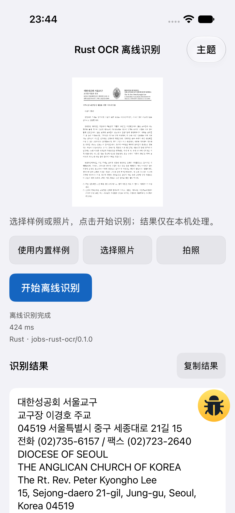
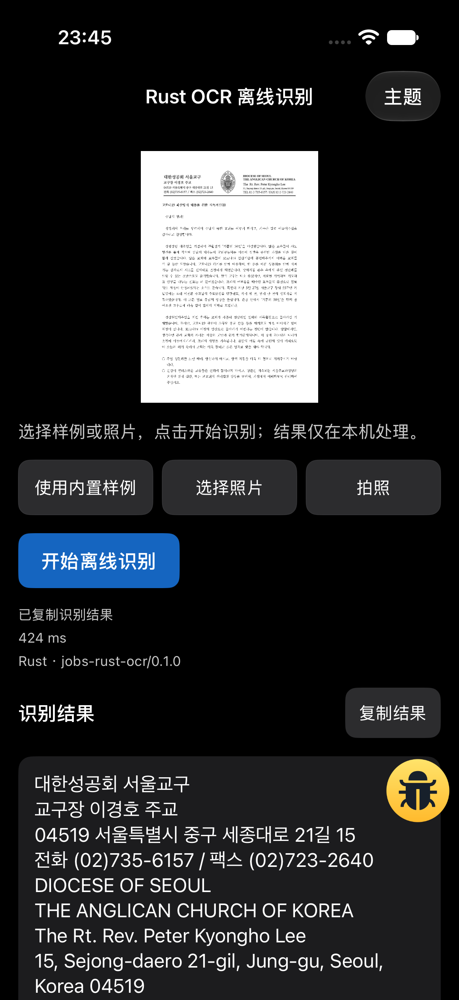

# Rust OCR 页面验证截图

2026-11-16，专用 iOS 27.2 模拟器，本批真实 App 与共享 Rust 核心。通过页面右上唯一“主题”菜单实际选择白天、黑夜及跟随系统；识别结果、滚动与系统相机取消状态保持。

| 白天 | 黑夜 |
| --- | --- |
|  |  |

完整用例 1 项／零失败／33.238 秒；真实结果 `engine=jobs-rust-ocr/indra`、35 行／1326 字符，真实剪贴板与结果逐字一致。系统照片相机呈现与取消已验，未执行模拟器拍摄或声称实体相机通过。其余九语实屏、大字号、相册选择、拒绝权限与运行中取消竞争另验。

原始 JSON、剪贴板、构建／UI 日志及全部七张 PNG 位于共享 OCR 工程 `测试/报告与证据/iOS/SwiftUI/SourceDeliveryUI-20261116`；原始结果包 `work/Validation/OCRSourceUI/SwiftUI-source-ui-1.xcresult`。本目录只保存已实际查看的浅深两张，避免将模拟器覆盖范围写为全平台验收。

[返回接入资产盘点](../RustOCR接入盘点.md)
